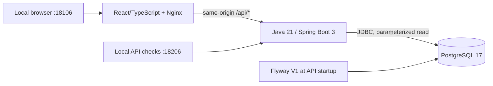

# Architecture

## Current vertical slice

Only web and API publish ports, both on `127.0.0.1`. They share an `edge` bridge
network so Docker Desktop can publish the loopback listeners. The API also joins
the internal `local` network with PostgreSQL; the web and smoke containers do not
join the database network. PostgreSQL publishes no port and has no external
network. There is no external application-service dependency, but the edge bridge
is not an outbound firewall. Separate, temporary tooling containers use a tooling
network to download public dependencies. No Docker socket is mounted.

The check script verifies host HTTP access as well as container-network access.
This is deliberate: healthy services on an internal-only network did not expose
usable host ports on the verified Docker Desktop version.

## Monorepo boundaries

- `apps/web`: scroll-driven page, the WebGL field (`src/field`), the live proof
  console, typed response validation, and frontend tests.
- `services/api`: request validation, structured errors/logs, JDBC, Flyway, health.
- `packages/contracts`: OpenAPI for the implemented skeleton.
- `infra/docker`: Compose, runtime Dockerfiles, Nginx configuration.
- `tests/e2e`: real HTTP and isolated Chromium checks through running services.
- `scripts`: PowerShell orchestration with checked exit codes.
- `docs`: requirements, safety, decisions, progress, and observed evidence.

The guide's worker and benchmark directories are reserved for the phases that
actually require them. Empty placeholder workers and fictional benchmarks are
deliberately not added.

## Persistence

Flyway V1 creates `skeleton_fixtures` and inserts a single immutable synthetic
fixture. It is infrastructure-test state, not a premature implementation of
the domain model. Both skeleton routes read it from PostgreSQL using a bound
query parameter. The application does not expose a write route.

Flyway migrations are forward-only in this slice. Automatic rollback or data
deletion is not safe by default. A future schema rollback must have a reviewed
data-preservation plan and explicit approval.

## API and errors

The skeleton JSON declares project, phase, fixture ID, database state, and disabled
telemetry/patch automation. A POST accepts only `fixtureId: "synthetic-demo"`.
Unknown JSON properties, malformed JSON, and invalid fields are rejected.
Errors use RFC 9457 problem details with a server-generated `requestId`.
Rejected values, exception internals, request bodies, query strings, and
credentials are not copied into error responses or request logs.

Health details are not exposed. Readiness includes the DB; liveness does not.
DB failures return 503 and are logged explicitly without a success fallback.
The contract file is packaged into the API and served at `/openapi.yaml`.

## Build and runtime

Maven/Java 21 compiles and tests the API. Node 24 runs locked npm installs,
Prettier, TypeScript, Vitest, and Vite. These tooling containers are sequential
and bounded. Runtime image builds only copy already-verified artifacts.
The API and web run non-root with read-only filesystems and bounded temporary
directories. Database data lives in a project-scoped named volume.

Expected steady-state caps: API 512 MiB / 0.75 CPU; database 256 MiB / 0.5 CPU;
web 64 MiB / 0.25 CPU. Tooling is capped separately and does not run as a daemon.
Chromium tests use a matching Playwright image with one worker, 768 MiB, 1 CPU,
256 PIDs, a read-only filesystem, and bounded temporary storage. The non-root
browser container mounts only its tests, configuration, and installed packages,
not database credentials or a Docker socket. Its default no-sandbox Chromium
mode is restricted to this trusted synthetic application; it is not a sandbox
for browsing untrusted sites.

## Deferred interfaces

`POST /telemetry`, `GET /incidents`,
`POST /incidents/{id}/reproduce`, and
`POST /incidents/{id}/propose-fix` are future domain contracts, not current routes.
Redis, Kafka, OpenTelemetry export, worker execution, AI providers, repository
credentials, and AWS/Kubernetes integration are absent. These need new phase
work and, where applicable, explicit consent or authorization.
